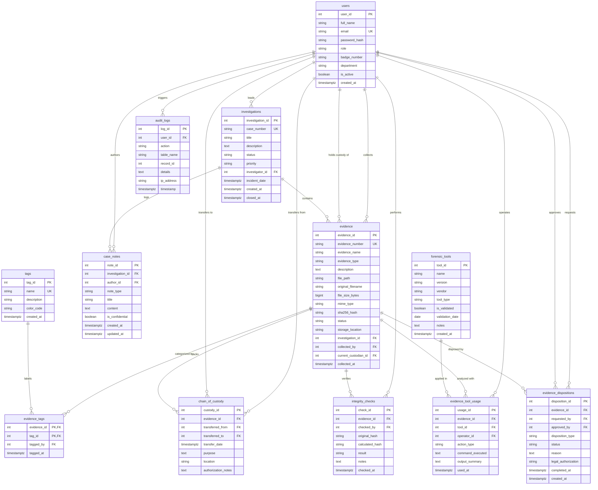

# Digital Forensics Evidence Tracker - Entity Relationship Diagram

This document illustrates the complete relational database architecture consisting of 12 core tables powering the Digital Forensics Evidence Tracker in PostgreSQL 17.

## Relational Summary

1. **`users`**: Personnel directory storing hashed credentials, roles, badges, and department affiliations.
2. **`investigations`**: Top-level case dossiers with priority levels, lifecycle statuses, and incident timelines.
3. **`evidence`**: Registered physical and digital artifacts with streaming SHA-256 baseline hashes and dual custodian bindings.
4. **`chain_of_custody`**: Append-only transactional transfer ledger maintaining unbroken legal custody under Federal Rules of Evidence.
5. **`integrity_checks`**: On-demand and periodic cryptographic verification audits verifying artifact hash integrity.
6. **`audit_logs`**: System audit trail populated automatically via PostgreSQL 17 triggers on data mutations.
7. **`tags`**: Controlled forensic taxonomy (e.g. Malware, Volatile Memory, Network PCAP).
8. **`evidence_tags`**: Associative junction table linking artifacts with classification tags.
9. **`case_notes`**: Chronological investigative observations, findings, and hypotheses with optional confidentiality flags.
10. **`forensic_tools`**: Inventory of NIST CFTT validated hardware write-blockers and software suites.
11. **`evidence_tool_usage`**: Scientific reproducibility logs detailing every tool invocation on evidence.
12. **`evidence_dispositions`**: Controlled disposition requests (retention, destruction, court presentation) requiring two-party signoff.
